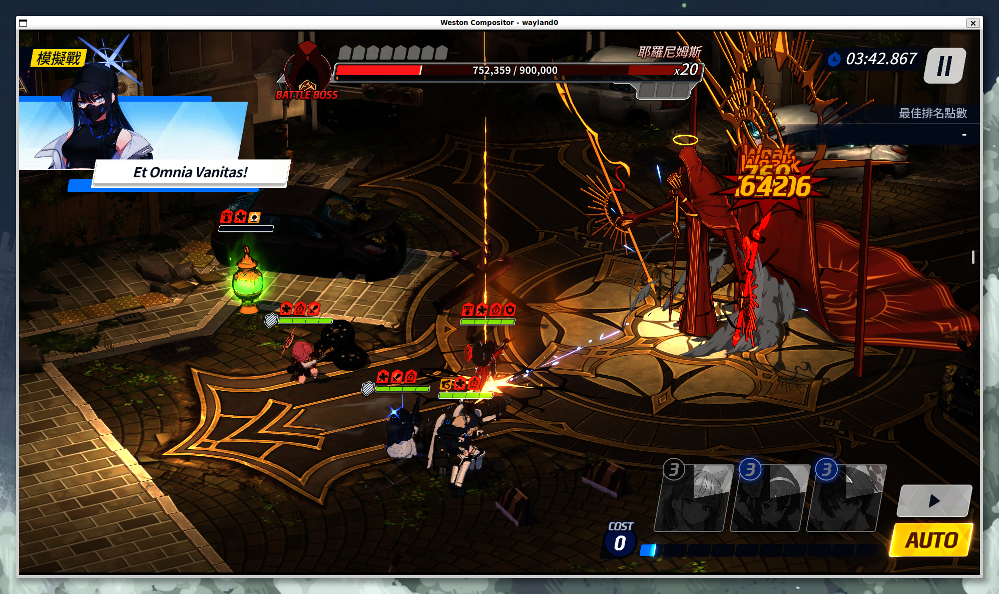
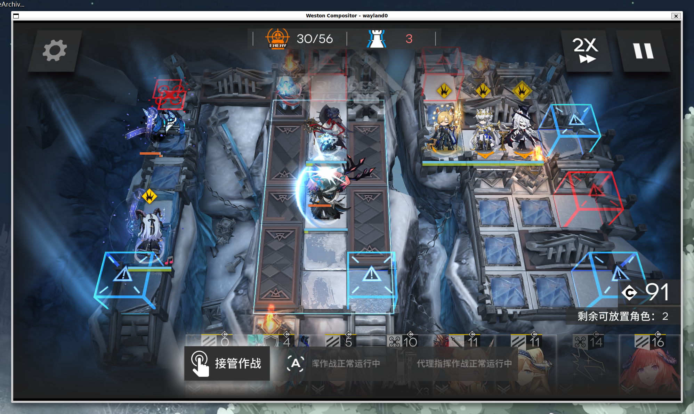
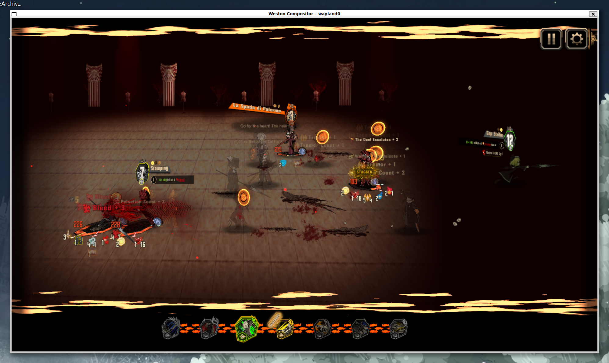

# WSL-Waydroid-ACC

[简体中文](README.md) | English

## 0. Before you start

This project was developed entirely with DeepSeek V4.1 Flash 1017 and GPT-6.2 Astra. It is an alpha experiment, not a thoroughly tested release. Long-term maintenance is not guaranteed; the intention is to share an approach that others can improve on.

The project modifies Android system libraries. Applications may detect those changes. The author accepts no responsibility for account bans resulting from use of this project.

## 1. Overview

**WSL-Waydroid-ACC is an alpha integration project for running x86_64 Waydroid on WSL2.** It builds on an existing Waydroid installation so Android apps can use the Windows host GPU and appear on the Windows desktop. The repository also brings together window management, input, debugging tools and optional ARM64 app support. It does not ship a complete WSL distribution or Android system image.

| Component | What it provides |
| --- | --- |
| GPU acceleration and desktop integration | Mesa D3D12 renders on the Windows host GPU. Eligible frames reach a nested Weston compositor through shared textures. The runtime package also provides window size and aspect-ratio controls, mouse-to-touch input, virtual multitouch, ADB forwarding to Windows localhost and lossless PNG screenshots. [Runtime package](deploy/wsl-waydroid-acc/) · [Integration details and tests](docs/MISC.md#english) |
| ARM64 app compatibility (optional) | Digitalis lets x86_64 Waydroid run ARM64 applications. The current version uses CC1 and short-leaf optimizations. It installs separately through the Waydroid overlay and does not require KernelSU. [Deployment package](deploy/digitails/) · [Source patches and guide](system-optimize/digitails/README.md#english) |
| Android system tuning (optional) | A KernelSU module enables on-demand shader compilation in SurfaceFlinger to reduce memory use. GPU acceleration does not require the module. [Module and test results](system-optimize/README.md#english) |

The [offline deployment guide](deploy/README.md#english) lists the verification and installation commands for both prebuilt packages. The runtime package is built from the [current runtime](runtime/SHA256SUMS) and [host libraries](host/SHA256SUMS); it does not install Digitalis or the KernelSU module. Once deployed, the runtime does not depend on the source checkout or the NDK.

## 2. Project documentation

- [GPU acceleration and its limits](docs/GPU-ACC.md#english): follow a frame from an application's EGL/GLES calls to Weston, including where textures are shared and where copies or synchronization remain.
- [Known issues](docs/KNOWN-ISSUE.md#english): image and game issues observed in testing, with workarounds where available.
- [Unfinished work](docs/UNFINISHED.md#english): unpackaged modules, open questions and experiments not adopted.

## 3. Launcher

After deployment, run `sudo waydroid-acc-start` in WSL to start or restart the installed version. The [launcher](services/waydroid-acc-start) runs independently of the source checkout. Use `waydroid-acc-start --help` to list its options.

**Window, resolution and input:** `-w` is short for `--weston`; `-r` for `--resolution`. `-m` is short for `--mouse`. The options can be used independently, in any order. Resolution refers to the **Android content area**, not the title bar, borders or Windows DPI scaling. Each invocation restarts the session; it does not resize it live or save the arguments as new defaults.

| WSL command | Window behavior |
|---|---|
| `sudo waydroid-acc-start` | Start at 1920×1080 with Weston's usual free resizing. |
| `sudo waydroid-acc-start -r 1600x900` | Start at 1600×900; still freely resizable. |
| `sudo waydroid-acc-start -w fix -r 1280x720` | Fix the content area at 1280×720. The window can be moved or closed; ordinary edge drags do not resize it. |
| `sudo waydroid-acc-start --weston ratio --resolution 1280x720` | Keep Android at 1280×720; fit the content into a resizable outer window, centered at its original aspect ratio with black bars. |
| `sudo waydroid-acc-start -m touch` | In Android content, left-click and drag act as one finger; hover, right-click and wheel (including Ctrl+wheel) send no mouse events. Hold either Ctrl key, press the left button, then drag at least 4 content pixels to pinch around **the center of the Android content**. One contact follows the cursor and the other mirrors it across that center. Drag toward the center to pinch or away from it to spread. Letterbox bars are excluded. A stationary Ctrl-click sends no touch; releasing Ctrl or the button ends the gesture. Omit the option or use `-m pointer` for normal mouse input. |

Use `WIDTHxHEIGHT`; both axes accept integers from 128 to 8192. This does not mean every size has been stress-tested on the GPU, in games or under memory pressure. The aspect ratio comes from `-r`, not a hard-coded 16:9. Fixed mode requests a normal-window size lock through xdg-shell; forced snapping and cross-monitor DPI behavior depend on WSLg. Scaling uses the GL viewport of one EGL window without readback. Non-native sizes redraw the whole frame rather than reusing native damage rectangles. Virtual touch axes follow the startup size. Non-1080p modes do not expand the validated shared-texture or PNG fast-path allowlists. The current version includes the custom Wayland backend and disables the Weston top panel. [Window and input verification](docs/MISC.md#weston-window-and-input-en)

Deployment starts the container once to verify the display stack. On success it disables boot-time startup of `waydroid-container.service` without stopping the current session. Opening WSL alone will not start Weston via `multi-user.target`; run `sudo waydroid-acc-start` when you want the UI.

## 4. Test results

### Test environment

Host, WSL and image versions below were recorded on 2026-11-20. The ARM64 compatibility row describes the current test setup.

| Component | Measured version or configuration |
|---|---|
| Windows | Windows 11 Pro Insider Preview, x64, OS build `29708.1003` |
| GPU / Windows driver | AMD Radeon RX 7900 XTX, display driver `32.0.32029.2010` |
| WSL / WSLg | WSL `3.0.5.0`, distribution in WSL 2 mode; WSLg `1.0.79` |
| WSL distribution | Ubuntu `26.04.1 LTS` (Resolute Raccoon), x86_64 |
| WSL kernel | `uname -r`: `7.2.8-microsoft-standard-WSL2`, selected in `.wslconfig`; the bundled kernel reported by `wsl --version` was `6.18.58.1-1` |
| Waydroid | `1.6.3`, container vendor type `MAINLINE` |
| Waydroid image | Android 16, LineageOS 23.2, `ro.lineage.version=23.2-20260717-UNOFFICIAL-WayDroidATV-waydroid_x86_64`. OTA channel `a16-qpr2`, `GAPPS` system image, security patch `2026-07-01` |
| Renderer and display | SurfaceFlinger reported `D3D12 (AMD Radeon RX 7900 XTX)`, OpenGL ES 3.1, Mesa 26.0.8. Nested Weston 14.0.2. Android's physical output then was 1920 × 1048; the current version defaults to 1920 × 1080. |
| ARM64 app compatibility | The test environment uses the [Digitalis translator (CC1 + short-leaf)](deploy/digitails/) and MuMu’s ARM64 guest library at `/system/lib64/arm64/libnativebridge.so`. The MuMu library is not distributed in this repository. |

### Performance

On 2026-11-22, each game was sampled for 120 s at 0.5 s intervals. Android reported a physical output of 1920×1080; each run contributed about 119.5 s of valid foreground game-layer data. These are single runs, not repeatability estimates.

| Game (versionCode) | Average FPS | 1% low FPS | Mean WSL CPU | Waydroid working set, mean / peak (GiB) |
|---|---:|---:|---:|---:|
| Blue Archive (474931) | 56.62 | 13.94 | 11.01% | 4.63 / 4.69 |
| Arknights (210) | 56.71 | 23.59 | 15.98% | 6.78 / 7.43 |
| Limbus Company (494) | 40.73 | 6.94 | 19.89% | 5.55 / 5.63 |

FPS measures Android game-buffer readiness, not Windows presentation. The 1% low is the reciprocal of the mean duration of the slowest 1% of complete frame intervals. CPU is for all of WSL on a 0–100% scale; memory is the estimated working set of Waydroid and its host services, excluding inactive file cache.

Blue Archive includes loading into battle: the two single-digit sampling windows occurred around 87 s and remain in the figures.

#### Game screenshots

| Blue Archive | Arknights | Limbus Company |
|:---:|:---:|:---:|
| [](preview/BlueArchive.png) | [](preview/Arknights.png) | [](preview/LimbusCompany.png) |

## 5. Build instructions

### Upstream sources used by the current version

`build.sh` unpacks the bundled Mesa and Weston sources and applies local files from [mesa/](mesa/) and [weston/](weston/). Use the commits below to check out upstream originals and compare changes. The actual build inputs are the repository's archives and overlays. [Archive SHA-256 manifest](vendor/SHA256SUMS) · [Build script](build.sh)

| Upstream | Tag / commit | Used for |
|---|---|---|
| Mesa | `mesa-26.0.8` → `60e95b787857afbc9a00b693b91c0d9c8923a430` | Gallium D3D12, texture export and synchronization. The commit in the original archive matches the tag. [Commit](https://gitlab.freedesktop.org/mesa/mesa/-/commit/60e95b787857afbc9a00b693b91c0d9c8923a430) |
| Weston | `14.0.2` → `015b3b4d4c05da44a22349ea6e651d1a8f678c59` | Modified `libweston-14.so.0`, `gl-renderer.so` and private `wayland-backend.so`. Host Weston package: `14.0.2-5`. [Commit](https://gitlab.freedesktop.org/wayland/weston/-/commit/015b3b4d4c05da44a22349ea6e651d1a8f678c59) |
| BLAKE3 | `1.8.2`; archive commit `df610ddc3b93841ffc59a87e3da659a15910eb46` | 32-byte broker CPU-mirror digest. Builds C and x86-64 assembly directly from the bundled upstream crate; no Cargo, network or runtime BLAKE3 shared library. The archive contains upstream licenses. [Commit](https://github.com/BLAKE3-team/BLAKE3/commit/df610ddc3b93841ffc59a87e3da659a15910eb46) |
| libdeflate | [v1.23](https://github.com/ebiggers/libdeflate/tree/v1.23); SHA-256 in the [vendor manifest](vendor/SHA256SUMS) | Only the sources needed for x86-64 compression and checksums are built into the Android PNG encoder; no runtime shared library. [License](vendor/libdeflate-COPYING) |
| Microsoft DirectX-Headers | System headers: `v1.619.1` → `9e393d6d8a3b30dcc6f2806ef604ec16a27b0d7e`, Ubuntu package `1.619.1-1` | Mesa's Meson log confirms pkg-config selected the system headers. The Mesa archive also contains fallback checkout `v1.618.1` (`64c650b0c6642ab0f3cdf674e38401e02ccd2460`). [System commit](https://github.com/microsoft/DirectX-Headers/commit/9e393d6d8a3b30dcc6f2806ef604ec16a27b0d7e) · [Bundled commit](https://github.com/microsoft/DirectX-Headers/commit/64c650b0c6642ab0f3cdf674e38401e02ccd2460) |
| Wayland | `1.24.0` → `736d12ac67c20c60dc406dc49bb06be878501f86` | Android HWC uses the bundled client headers, verified against Ubuntu `libwayland-dev 1.24.0-2`. The client protocol code identifies `wayland-scanner 1.24.0`; the Weston side is generated from this project's XML at build time. [Commit](https://gitlab.freedesktop.org/wayland/wayland/-/commit/736d12ac67c20c60dc406dc49bb06be878501f86) · [Shared-texture protocol](weston/texture.xml) |
| wayland-protocols | `1.47` → `88223018d1b578d0d8869866da66d9608e05f928` | Standard protocols used by Weston; Meson detected Ubuntu `1.47-1`. [Commit](https://gitlab.freedesktop.org/wayland/wayland-protocols/-/commit/88223018d1b578d0d8869866da66d9608e05f928) |
| Android NDK | `r27c`, revision `27.2.12479018` | Android x86_64 toolchain and sysroot, including the ANGLE `EGL/Platform.h` used by `platform.cpp`. No separate ANGLE source checkout. [NDK checksum](toolchains/android-ndk-r27c/SHA256SUMS) |

**Android HAL and window headers.** `include/hardware/{hardware,gralloc,fb}.h` and `include/cutils/native_handle.h` originally came from the AOSP GitHub mirror's `main` branch; no commit was pinned at download time. The examples below match the indicated `android16-qpr2-release` files byte for byte. Other compatibility headers are locally trimmed; these matches do not identify the entire Android image's repo manifest.

| AOSP repository | Comparison commit | Files verified |
|---|---|---|
| `platform/hardware/libhardware` | [`67b44bb0f7d1df962e737cfe9baf716bab45792e`](https://android.googlesource.com/platform/hardware/libhardware/+/67b44bb0f7d1df962e737cfe9baf716bab45792e) | [hwcomposer.h](src/hardware/hwcomposer.h), [hwcomposer_defs.h](src/hardware/hwcomposer_defs.h), [gralloc.h](include/hardware/gralloc.h) |
| `platform/system/core` | [`e9d1fa3705d7fbd0ac1c942bc4c276161bfbfed1`](https://android.googlesource.com/platform/system/core/+/e9d1fa3705d7fbd0ac1c942bc4c276161bfbfed1) | [native_handle.h](include/cutils/native_handle.h), [properties.h](include/android_stub/cutils/properties.h) |
| `platform/frameworks/native` | [`fcbde2bcff56ca1d7bec9cabf8bdca5e288bf103`](https://android.googlesource.com/platform/frameworks/native/+/fcbde2bcff56ca1d7bec9cabf8bdca5e288bf103) | [vndk/window.h](include/android_stub/vndk/window.h), [nativebase.h](include/android_stub/nativebase/nativebase.h) |
| `platform/system/logging` | [`58dac317ea08b8f275ebd01ce864acab2de30b93`](https://android.googlesource.com/platform/system/logging/+/58dac317ea08b8f275ebd01ce864acab2de30b93) | [log.h](include/android_stub/log/log.h), [log_id.h](include/android_stub/log/log_id.h) |

**Runtime versions.** Waydroid container manager `1.6.3` corresponds to `5b7e2e71be3f6bfaaaab3b461251dacaf1ce4991`. The graphics adapter loads the image's `hwcomposer.vendor-base.so` at runtime. Its exact source commit is unknown; deployment pins the binary by SHA-256: `942fad47d8372ea1eb6873a8ccad0954d91592b0fc6137d8eff2f638043f1a29`. See [Test environment](#test-environment) for the full LineageOS image ID. [Waydroid commit](https://github.com/waydroid/waydroid/commit/5b7e2e71be3f6bfaaaab3b461251dacaf1ce4991) · [HAL loading](src/adapter.c) · [Deployment checks](deploy/wsl-waydroid-acc/deploy.sh)

The test machine's separately built WSL kernel used `ZoeHao2026/wsl-kernel-7.2.8` at `53bb4a4b310111d020155333d1a378cbc80af869`. It is based on Linux stable `v7.2.8`, with Microsoft WSL changes ported from `linux-msft-wsl-6.18.40.1` (`14794180686c2fb6307fbe359c359bec765249f3`). [Kernel port and versions](https://github.com/ZoeHao2026/wsl-kernel-7.2.8/tree/53bb4a4b310111d020155333d1a378cbc80af869) · [Microsoft WSL kernel commit](https://github.com/microsoft/WSL2-Linux-Kernel/commit/14794180686c2fb6307fbe359c359bec765249f3)

### 5.1 WSL kernel and devices

`build.sh` builds userspace components. Offscreen GPU tests require a working WSL D3D12 device. Running Waydroid also requires Binder, graphics buffers, container networking and image mounts. Check these options to reproduce the test configuration (`=y`: built in; `=m`: module).

| Purpose | Test kernel configuration | What to verify |
|---|---|---|
| Host GPU | `CONFIG_HYPERV=y`, `CONFIG_HYPERV_VMBUS=y`, `CONFIG_DXGKRNL=y` | WSL and the container can access `/dev/dxg`; WSL provides `/usr/lib/wsl/lib/libd3d12.so` and `libdxcore.so`. |
| Android IPC and shared memory | `CONFIG_ANDROID_BINDER_IPC=y`, `CONFIG_ANDROID_BINDERFS=y`, `CONFIG_MEMFD_CREATE=y` | `/dev/binderfs` provides Binder devices; the container exposes `/dev/binder`, `/dev/hwbinder` and `/dev/vndbinder`. |
| Graphics buffers and synchronization | `CONFIG_DMA_SHARED_BUFFER=y`, `CONFIG_DMABUF_HEAPS=y`, `CONFIG_DMABUF_HEAPS_SYSTEM=y`, `CONFIG_SYNC_FILE=y` | `/dev/dma_heap/system` exists and can allocate system-memory buffers. |
| DRM devices used by this image | `CONFIG_DRM=y`, `CONFIG_DRM_VKMS=m`, `CONFIG_DRM_VGEM=m` | `vkms` and `vgem` are loaded. `gralloc.gbm.device` points to VKMS at `/dev/dri/card1`; `renderD128` is VGEM. Actual GPU rendering uses `/dev/dxg`. |
| Virtual multitouch | `CONFIG_INPUT=y`, `CONFIG_INPUT_EVDEV=m`, `CONFIG_INPUT_UINPUT=m` (or built in) | Modules must match the kernel. The touch service loads them on demand; no modules-load.d entry is needed. |
| Android images and writable layer | `CONFIG_BLK_DEV_LOOP=y`, `CONFIG_EROFS_FS=m`, `CONFIG_EXT4_FS=y`, `CONFIG_OVERLAY_FS=y` | The system image uses EROFS and vendor uses ext4; a writable overlay is mounted at runtime. |
| LXC and container networking | `CONFIG_NAMESPACES=y` with `UTS_NS`, `IPC_NS`, `USER_NS`, `PID_NS`, `NET_NS`; `CONFIG_CGROUPS=y`, `CONFIG_CGROUP_BPF=y`, `CONFIG_VETH=y`, `CONFIG_BRIDGE=m`, `CONFIG_BRIDGE_NETFILTER=m`, `CONFIG_NF_CONNTRACK=y`, `CONFIG_NF_NAT=y` | The test machine uses cgroup v2 and the `waydroid0` bridge. |

A custom kernel must retain WSL Hyper-V and dxgkrnl support. The module VHDX must match the booted kernel. Select the files with `kernel` and `kernelModules` under `[wsl2]` in the Windows user's `.wslconfig`. Stage sampling with `out/validation/measure.py` also requires `CONFIG_FTRACE=y` and `CONFIG_UPROBE_EVENTS=y`. [Microsoft kernel build instructions](https://github.com/microsoft/WSL2-Linux-Kernel#build-instructions) · [Custom kernel configuration](https://learn.microsoft.com/en-us/windows/wsl/wsl-config)

Check the current kernel and devices in WSL. `/proc/config.gz` requires `CONFIG_IKCONFIG_PROC`.

```bash
uname -r
zgrep -E '^CONFIG_(DXGKRNL|ANDROID_BINDER_IPC|ANDROID_BINDERFS|DMABUF_HEAPS_SYSTEM|SYNC_FILE|DRM_VKMS|DRM_VGEM|EROFS_FS)=' /proc/config.gz
ls -l /dev/dxg /dev/dma_heap/system /dev/binderfs /dev/dri
```

### 5.2 Build dependencies on Ubuntu 26.04 LTS

In Bash on x86_64 Ubuntu, install the host compiler, Mesa/Weston build tools and development packages. `directx-headers-dev` is in Ubuntu's `universe` component; `libwayland-bin` supplies `wayland-scanner`. The Android build uses the bundled NDK r27c (27.2.12479018). [Ubuntu DirectX-Headers package](https://packages.ubuntu.com/source/resolute/directx-headers) · [Build script](build.sh)

```bash
sudo apt update
sudo apt install git-lfs build-essential binutils meson ninja-build pkgconf bison flex \
  python3 python3-mako python3-packaging python3-yaml directx-headers-dev \
  libdrm-dev libelf-dev libexpat1-dev zlib1g-dev libzstd-dev libdisplay-info-dev \
  libwayland-bin libwayland-dev wayland-protocols libudev-dev libinput-dev \
  libevdev-dev libxkbcommon-dev libxcb1-dev libpixman-1-dev libgbm-dev \
  libegl-dev libgl-dev libgles-dev libpng-dev libcairo2-dev libpango1.0-dev \
  libfontconfig-dev libglib2.0-dev liblcms2-dev libssl-dev libsystemd0
```

### 5.3 Build, offscreen validation and deployment

Run these commands from the root of a Git clone. Fetch the archives with Git LFS first; a pointer file cannot be used as build input. The script verifies the manifests in `toolchains/`, `vendor/` and `host/`, unpacks the NDK and prepares the Mesa/Weston builds in the WSL user's cache. It writes the graphics binaries (including the private Wayland window backend), WSL touch program, Android PNG encoder and SHA-256 manifest to `out/build/`. A normal build needs no private test files. Maintainers with a local `out/validation/check.c` can optionally add `--offscreen`.

```bash
git lfs pull
unset NDK ANDROID_NDK_HOME ANDROID_NDK_ROOT
JOBS=4 bash build.sh
(cd out/build && sha256sum -c SHA256SUMS)
```

Deployment targets a **Waydroid instance already configured with this project's Android graphics libraries and overlay**. It requires WSLg, systemd and compatible Weston. On another machine, check the WSL user in the service templates, the vendor HAL in the image and the WSL graphics libraries in the container. Deploying restarts both Waydroid and nested Weston. [Deployment script](deploy/wsl-waydroid-acc/deploy.sh) · [Host service templates](services/systemd/)

| WSL command | Action |
|---|---|
| `bash deploy/wsl-waydroid-acc/deploy.sh verify` | Verify the archive, unpack it in a temporary directory and check the bundled runtime and host libraries. No root or installation required. |
| `sudo bash deploy/wsl-waydroid-acc/deploy.sh built` | Deploy the new `out/build/` and development `services/`, without changing the prebuilt archive for the current version. |
| `sudo bash deploy/wsl-waydroid-acc/deploy.sh apply` or `sudo bash deploy/wsl-waydroid-acc/deploy.sh restore` | Install or restore the current runtime and host libraries from the adjacent archive. The deployment directory can be copied on its own; no build required. No argument means `apply`. |

Host programs and Weston modules are installed in `/usr/local/lib/wsl-waydroid-acc/`; Android components go into the overlay and container data directory. This image also has an optional `services.jar` change for the startup GPU-status warning.

For Windows ADB access, virtual multitouch and faster lossless PNG screenshots, see [Additional configuration and test results](docs/MISC.md#english).

## License

Original project material is licensed under the [GNU General Public License, version 3](LICENSE), or (at your option) any later version (`GPL-3.0-or-later`). Third-party components retain their own licenses and copyright notices; see [Third-party notices](THIRD_PARTY_NOTICES.md#english).
