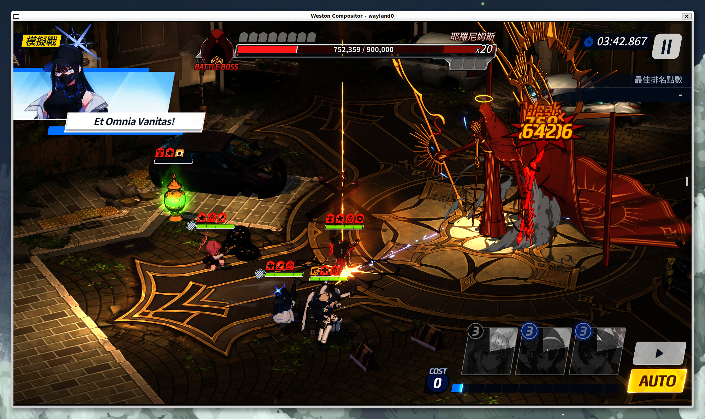
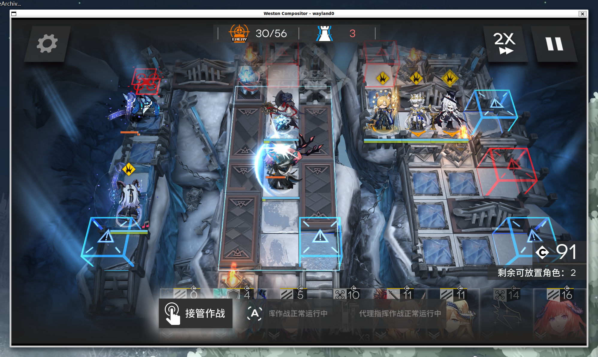
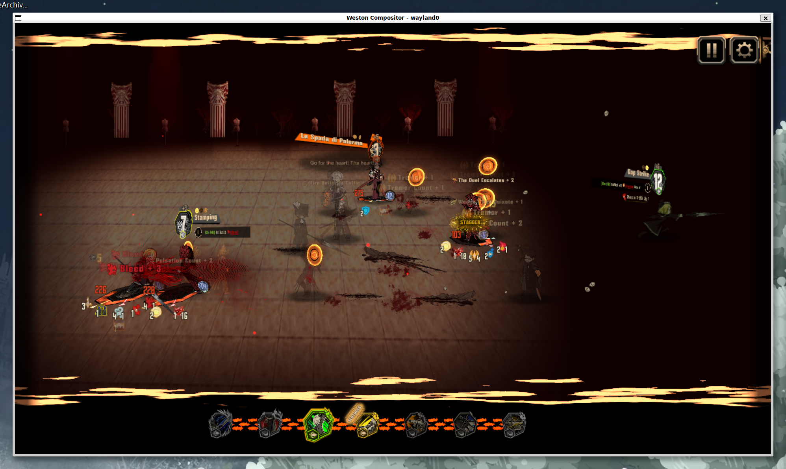

# WSL-Waydroid-ACC

简体中文 | [English](README.en.md)

## 0. 注意

本项目完全由 deepseek v4.1 flash 1017 与 gpt-6.2 astra 完成, 未经过充分测试, 可能不会长期维护, 更多是抛砖引玉, 希望能有更好的实现

本项目修改了安卓系统库, 可能会被检测, 若由于本项目导致账号封禁, 本人概不负责

## 1. 项目简介

**WSL-Waydroid-ACC 是面向 WSL2 的 x86_64 Waydroid 整合项目，目前处于 alpha 阶段。** 以已有的 Waydroid 实例为基础，让 Android 应用能在 Windows 桌面上使用宿主 GPU，并把窗口、输入、调试和可选的 ARM64 应用兼容方案放在同一套文档和工具中。仓库不提供完整的 WSL 发行版或 Android 系统镜像。

| 组成 | 提供的能力 |
| --- | --- |
| GPU 加速与桌面集成 | Mesa D3D12 使用 Windows 宿主 GPU 渲染，符合条件的画面通过共享纹理交给嵌套 Weston 显示。运行包还提供窗口尺寸与比例控制、鼠标转触摸、虚拟多点触屏、Windows 本机 ADB 转发和无损 PNG 截图。[运行包](deploy/wsl-waydroid-acc/) · [集成说明与测试](docs/MISC.md) |
| ARM64 应用兼容（可选） | Digitalis 让 x86_64 Waydroid 可以运行 ARM64 应用。当前版本采用 CC1 + 短叶函数，通过 Waydroid overlay 单独安装，不依赖 KernelSU。[部署包](deploy/digitails/) · [源码补丁与说明](system-optimize/digitails/README.md) |
| Android 系统调优（可选） | 通过 KernelSU 模块让 SurfaceFlinger 按需编译着色器，以降低内存占用；它不是 GPU 加速的前置条件。[模块与测试记录](system-optimize/README.md) |

[离线部署说明](deploy/README.md)列出了两个预编译包的校验与安装命令。运行包从[当前版本的运行文件](runtime/SHA256SUMS)和[宿主库](host/SHA256SUMS)打包，不会自动安装 Digitalis 或 KernelSU 模块。部署完成后，运行不依赖源码树或 NDK。

## 2. 项目文档

- [GPU 加速实现与瓶颈](docs/GPU-ACC.md)：从应用的 EGL/GLES 调用到 Weston 显示一帧，看哪些步骤共享 GPU 纹理、哪些仍需要拷贝或同步。
- [已知问题](docs/KNOWN-ISSUE.md)：测试中遇到的镜像和游戏问题，以及已知的规避方法。
- [未实现的方向](docs/UNFINISHED.md)：尚未打包的模块、待验证的方案，以及实测后未采用的方案。

## 3. 启动脚本

部署后，在 WSL 中运行 `sudo waydroid-acc-start` 即可启动或重启已安装的版本。[启动脚本](services/waydroid-acc-start)不依赖源码目录；用 `waydroid-acc-start --help` 可查看参数。

**窗口、分辨率与输入：** `-w` 是 `--weston` 的简写，`-r` 是 `--resolution` 的简写。`-m` 是 `--mouse` 的简写。参数可单独使用，顺序不限。分辨率是 **Android 内容区**，不含 Weston 标题栏、边框或 Windows DPI 换算。每次执行都是重新启动，不是在线调整当前会话；上次的参数不会作为下次默认。

| WSL 命令 | 显示行为 |
|---|---|
| `sudo waydroid-acc-start` | 以 1920×1080 启动，保留 Weston 原有自由调整大小行为 |
| `sudo waydroid-acc-start -r 1600x900` | 以 1600×900 启动，仍可自由调整窗口 |
| `sudo waydroid-acc-start -w fix -r 1280x720` | 固定 1280×720 内容区，保留移动与关闭，普通拖边不改大小 |
| `sudo waydroid-acc-start --weston ratio --resolution 1280x720` | Android 保持 1280×720，外窗可拖动缩放；按内容原比例居中，剩余区域留黑 |
| `sudo waydroid-acc-start -m touch` | 在 Android 内容区，左键点击和拖动模拟单指；空移、右键和滚轮（含 Ctrl＋滚轮）均不产生鼠标事件。先按住任一 Ctrl，再按住左键并拖动至少 4 个内容像素，以 **Android 画面中心**为对称中心：一指跟随光标，另一指在对侧镜像移动。向画面中心拖动会合拢，远离中心会张开；等比窗口的黑边不计入画面。单按不拖不落指；松开 Ctrl 或左键即结束。省略选项或用 `-m pointer` 保持普通鼠标模式。 |

尺寸格式为 `宽x高`，两轴均接受 128–8192 的整数；这不是所有分辨率都通过显卡、游戏或内存压力测试的保证。比例取自 `-r`，不是强制 16:9。固定模式通过 xdg-shell 请求锁定普通窗口；系统强制贴靠和跨屏 DPI 的处理取决于 WSLg。缩放时使用单个 EGL 窗口的 GL 视口，不读回图像；非原生尺寸时整帧重绘，不复用原分辨率的损伤矩形。虚拟触屏的轴范围跟随启动分辨率。非 1080p 不扩大已验证的共享纹理和 PNG 快速路径白名单。当前版本包含自定义 Wayland 后端，并关闭 Weston 顶栏。[窗口与输入验收](docs/MISC.md#4-weston-窗口与输入)

部署会启动一次容器以验证显示栈，成功后关闭 `waydroid-container.service` 的开机自启，不停止当前会话。下次仅打开 WSL 时，容器不会随 `multi-user.target` 拉起 Weston；需要图形界面时运行 `sudo waydroid-acc-start`。

## 4. 测试记录

### 测试环境

宿主、WSL 与镜像版本记录于 2026-11-20；ARM64 兼容配置一行列出当前测试环境已加载的组件。

| 项目 | 实测版本或配置 |
|---|---|
| Windows | Windows 11 专业版 Insider Preview，x64，OS Build `29708.1003` |
| GPU 和 Windows 驱动 | AMD Radeon RX 7900 XTX，显示驱动 `32.0.32029.2010` |
| WSL / WSLg | WSL `3.0.5.0`，发行版运行模式 WSL 2；WSLg `1.0.79` |
| WSL 发行版 | Ubuntu `26.04.1 LTS`（Resolute Raccoon），x86_64 |
| WSL 内核 | `uname -r` 实测 `7.2.8-microsoft-standard-WSL2`，由 `.wslconfig` 指定；`wsl --version` 报告的随附内核为 `6.18.58.1-1` |
| Waydroid | `1.6.3`，容器 vendor 类型 `MAINLINE` |
| Waydroid 系统镜像 | Android 16，LineageOS 23.2，`ro.lineage.version=23.2-20260717-UNOFFICIAL-WayDroidATV-waydroid_x86_64`。OTA 通道为 `a16-qpr2`，system 为 `GAPPS`，安全补丁日期为 `2026-07-01` |
| 实际渲染与显示 | SurfaceFlinger 报告 `D3D12 (AMD Radeon RX 7900 XTX)`、OpenGL ES 3.1、Mesa 26.0.8；嵌套 Weston 14.0.2，当日 Android 物理显示 1920 × 1048；当前版本默认 1920 × 1080 |
| ARM64 应用兼容配置 | 已加载 [Digitalis 转译层（CC1 + 短叶函数）](deploy/digitails/) 和 MuMu 的 ARM64 客体库 `/system/lib64/arm64/libnativebridge.so`。仓库不分发该 MuMu 库。 |

### 性能表现

2026-11-22 实机采样。Android 物理输出为 1920×1080；每款游戏采集 120 秒，间隔 0.5 秒，有效前台游戏图层记录均约 119.5 秒。每款取一轮，不代表多轮平均。

| 游戏（versionCode） | 平均 FPS | 1% low FPS | WSL 平均 CPU | Waydroid 工作集均值 / 峰值（GiB） |
|---|---:|---:|---:|---:|
| 碧蓝档案 (474931) | 56.62 | 13.94 | 11.01% | 4.63 / 4.69 |
| 明日方舟 (210) | 56.71 | 23.59 | 15.98% | 6.78 / 7.43 |
| Limbus Company (494) | 40.73 | 6.94 | 19.89% | 5.55 / 5.63 |

FPS 按 Android 游戏缓冲区就绪时间计算，不是 Windows 最终呈现帧率。1% low 取最慢 1% 完整帧间隔的平均耗时，再换算为 FPS。CPU 以整个 WSL 的全部虚拟核为 100%；内存为 Waydroid 容器及相关宿主服务扣除非活跃文件缓存后的估算工作集。

碧蓝档案包含进入战斗的加载：第 87 秒附近两个采样窗口降至个位数，表中未剔除。

#### 游戏运行截图

| 碧蓝档案 | 明日方舟 | Limbus Company |
|:---:|:---:|:---:|
| [](preview/BlueArchive.png) | [](preview/Arknights.png) | [](preview/LimbusCompany.png) |

## 5. 构建方法

### 当前版本使用的上游源码

复现当前版本时，`build.sh` 解包仓库内的 Mesa 和 Weston 源码，再应用 [mesa/](mesa/) 和 [weston/](weston/) 中的本地文件。下表的 Git 提交用于检出上游原版、比对本地改动；实际构建输入以仓库中的源码包和覆盖文件为准。[源码包 SHA-256](vendor/SHA256SUMS) · [构建脚本](build.sh)

| 上游 | 标签与对应提交 | 本项目使用位置 |
|---|---|---|
| Mesa | `mesa-26.0.8` → `60e95b787857afbc9a00b693b91c0d9c8923a430` | Gallium D3D12 驱动、纹理导出和同步。原始源码归档内的 Git 提交与标签一致。[上游提交](https://gitlab.freedesktop.org/mesa/mesa/-/commit/60e95b787857afbc9a00b693b91c0d9c8923a430) |
| Weston | `14.0.2` → `015b3b4d4c05da44a22349ea6e651d1a8f678c59` | 构建修改后的 `libweston-14.so.0`、`gl-renderer.so` 与私有 `wayland-backend.so`。宿主 Weston 软件包版本为 `14.0.2-5`。[上游提交](https://gitlab.freedesktop.org/wayland/weston/-/commit/015b3b4d4c05da44a22349ea6e651d1a8f678c59) |
| BLAKE3（输入 broker） | 发布版 `1.8.2`，归档中的 Git 提交 `df610ddc3b93841ffc59a87e3da659a15910eb46` | 输入 broker 的 CPU 镜像使用 32 字节摘要。构建直接编译仓库内官方 crate 的 C 与 x86-64 汇编实现，无需 Cargo、网络或运行时的 BLAKE3 动态库。归档含上游许可证。[上游提交](https://github.com/BLAKE3-team/BLAKE3/commit/df610ddc3b93841ffc59a87e3da659a15910eb46) |
| libdeflate（Android PNG 编码） | 发布版 [v1.23](https://github.com/ebiggers/libdeflate/tree/v1.23)，源码归档 SHA-256 见 [vendor 清单](vendor/SHA256SUMS) | 仅编译 x86-64 压缩和校验所需的源码，不依赖运行时共享库。[许可证](vendor/libdeflate-COPYING) |
| Microsoft DirectX-Headers | 实际编译使用 `v1.619.1` → `9e393d6d8a3b30dcc6f2806ef604ec16a27b0d7e` 对应的 Ubuntu 包 `1.619.1-1` | Mesa 的 Meson 记录显示通过 pkg-config 选中了系统头文件。Mesa 包内还保留了备用 checkout `v1.618.1`（`64c650b0c6642ab0f3cdf674e38401e02ccd2460`）。[系统版本上游提交](https://github.com/microsoft/DirectX-Headers/commit/9e393d6d8a3b30dcc6f2806ef604ec16a27b0d7e) · [归档版本上游提交](https://github.com/microsoft/DirectX-Headers/commit/64c650b0c6642ab0f3cdf674e38401e02ccd2460) |
| Wayland | `1.24.0` → `736d12ac67c20c60dc406dc49bb06be878501f86` | Android HWC 使用随仓库保存的客户端头文件，核对与 Ubuntu `libwayland-dev 1.24.0-2` 一致。客户端协议代码标注由 `wayland-scanner 1.24.0` 生成；Weston 端在构建时从本项目的 XML 生成。[上游提交](https://gitlab.freedesktop.org/wayland/wayland/-/commit/736d12ac67c20c60dc406dc49bb06be878501f86) · [共享纹理协议](weston/texture.xml) |
| wayland-protocols | `1.47` → `88223018d1b578d0d8869866da66d9608e05f928` | Weston 使用的标准协议集，Meson 检出的 Ubuntu 包为 `1.47-1`。[上游提交](https://gitlab.freedesktop.org/wayland/wayland-protocols/-/commit/88223018d1b578d0d8869866da66d9608e05f928) |
| Android NDK | `r27c`，包修订号 `27.2.12479018` | Android x86_64 工具链及 sysroot，包括 `platform.cpp` 使用的 ANGLE `EGL/Platform.h`。构建无独立 ANGLE 源码 checkout。[NDK 归档校验](toolchains/android-ndk-r27c/SHA256SUMS) |

**Android HAL 与窗口头文件。** `include/hardware/{hardware,gralloc,fb}.h` 和 `include/cutils/native_handle.h` 最初取自 AOSP GitHub 镜像的 `main` 分支，下载时没有固定提交。下表给出 AOSP `android16-qpr2-release` 中可复查的 checkout，所列示例与对应提交中的文件逐字节一致。仓库中的其余兼容头包含本地裁剪，无法据此推定整个 Android 镜像的 repo manifest。

| AOSP 仓库 | 对照提交 | 已核对的仓库内文件示例 |
|---|---|---|
| `platform/hardware/libhardware` | [`67b44bb0f7d1df962e737cfe9baf716bab45792e`](https://android.googlesource.com/platform/hardware/libhardware/+/67b44bb0f7d1df962e737cfe9baf716bab45792e) | [hwcomposer.h](src/hardware/hwcomposer.h)、[hwcomposer_defs.h](src/hardware/hwcomposer_defs.h)、[gralloc.h](include/hardware/gralloc.h) |
| `platform/system/core` | [`e9d1fa3705d7fbd0ac1c942bc4c276161bfbfed1`](https://android.googlesource.com/platform/system/core/+/e9d1fa3705d7fbd0ac1c942bc4c276161bfbfed1) | [native_handle.h](include/cutils/native_handle.h)、[properties.h](include/android_stub/cutils/properties.h) |
| `platform/frameworks/native` | [`fcbde2bcff56ca1d7bec9cabf8bdca5e288bf103`](https://android.googlesource.com/platform/frameworks/native/+/fcbde2bcff56ca1d7bec9cabf8bdca5e288bf103) | [vndk/window.h](include/android_stub/vndk/window.h)、[nativebase.h](include/android_stub/nativebase/nativebase.h) |
| `platform/system/logging` | [`58dac317ea08b8f275ebd01ce864acab2de30b93`](https://android.googlesource.com/platform/system/logging/+/58dac317ea08b8f275ebd01ce864acab2de30b93) | [log.h](include/android_stub/log/log.h)、[log_id.h](include/android_stub/log/log_id.h) |

**运行环境的版本边界。** Waydroid 容器管理程序使用 `1.6.3`（上游提交 `5b7e2e71be3f6bfaaaab3b461251dacaf1ce4991`）。图形适配层在运行时加载测试镜像自带的 `hwcomposer.vendor-base.so`；其独立源码提交未确认，部署脚本按 SHA-256 `942fad47d8372ea1eb6873a8ccad0954d91592b0fc6137d8eff2f638043f1a29` 锁定该二进制。完整 LineageOS 镜像标识见[测试环境](#测试环境)。[Waydroid 上游提交](https://github.com/waydroid/waydroid/commit/5b7e2e71be3f6bfaaaab3b461251dacaf1ce4991) · [HAL 加载入口](src/adapter.c) · [部署校验](deploy/wsl-waydroid-acc/deploy.sh)

测试机单独构建的 WSL 内核使用 `ZoeHao2026/wsl-kernel-7.2.8` checkout `53bb4a4b310111d020155333d1a378cbc80af869`。其基底为 Linux stable `v7.2.8`，移植的 Microsoft WSL 改动来自 `linux-msft-wsl-6.18.40.1`（`14794180686c2fb6307fbe359c359bec765249f3`）。[内核移植仓库及版本说明](https://github.com/ZoeHao2026/wsl-kernel-7.2.8/tree/53bb4a4b310111d020155333d1a378cbc80af869) · [Microsoft WSL 内核提交](https://github.com/microsoft/WSL2-Linux-Kernel/commit/14794180686c2fb6307fbe359c359bec765249f3)

### 5.1 WSL 内核与设备

`build.sh` 编译用户态组件。离屏 GPU 测试需要可用的 WSL D3D12 设备；启动完整 Waydroid 还需要 Binder、图形缓冲区、容器网络和镜像挂载支持。下表列出复现本机配置时应核对的内核选项。`=y` 表示内建，`=m` 表示按模块提供。

| 用途 | 测试内核的配置 | 验证点 |
|---|---|---|
| 宿主 GPU 通道 | `CONFIG_HYPERV=y`、`CONFIG_HYPERV_VMBUS=y`、`CONFIG_DXGKRNL=y` | WSL 和容器均可访问 `/dev/dxg`，WSL 提供 `/usr/lib/wsl/lib/libd3d12.so` 和 `libdxcore.so` |
| Android IPC 和共享内存 | `CONFIG_ANDROID_BINDER_IPC=y`、`CONFIG_ANDROID_BINDERFS=y`、`CONFIG_MEMFD_CREATE=y` | `/dev/binderfs` 提供 Binder 设备，容器映射出 `/dev/binder`、`/dev/hwbinder` 和 `/dev/vndbinder` |
| 图形缓冲区与同步 | `CONFIG_DMA_SHARED_BUFFER=y`、`CONFIG_DMABUF_HEAPS=y`、`CONFIG_DMABUF_HEAPS_SYSTEM=y`、`CONFIG_SYNC_FILE=y` | `/dev/dma_heap/system` 存在，可分配系统内存缓冲区 |
| 本镜像使用的 DRM 设备 | `CONFIG_DRM=y`、`CONFIG_DRM_VKMS=m`、`CONFIG_DRM_VGEM=m` | 本机加载 `vkms` 和 `vgem`。`gralloc.gbm.device` 指向 VKMS 的 `/dev/dri/card1`，`renderD128` 属于 VGEM；实际 GPU 渲染经 `/dev/dxg` |
| 虚拟多点触屏 | `CONFIG_INPUT=y`、`CONFIG_INPUT_EVDEV=m`、`CONFIG_INPUT_UINPUT=m`（亦可内建） | 模块须匹配当前内核，由触屏服务按需加载，不用写 modules-load.d |
| Android 镜像和可写层 | `CONFIG_BLK_DEV_LOOP=y`、`CONFIG_EROFS_FS=m`、`CONFIG_EXT4_FS=y`、`CONFIG_OVERLAY_FS=y` | 当前 system 镜像使用 EROFS，vendor 使用 ext4，运行时挂载可写 overlay |
| LXC 和容器网络 | `CONFIG_NAMESPACES=y`，启用 `UTS_NS`、`IPC_NS`、`USER_NS`、`PID_NS`、`NET_NS`；`CONFIG_CGROUPS=y`、`CONFIG_CGROUP_BPF=y`、`CONFIG_VETH=y`、`CONFIG_BRIDGE=m`、`CONFIG_BRIDGE_NETFILTER=m`、`CONFIG_NF_CONNTRACK=y`、`CONFIG_NF_NAT=y` | 本机使用 cgroup v2 和 `waydroid0` 网桥 |

自定义内核需保留 WSL 的 Hyper-V 与 dxgkrnl 支持，模块 VHDX 应与启动内核版本匹配。Windows 用户目录的 `.wslconfig` 可在 `[wsl2]` 下通过 `kernel` 和 `kernelModules` 选择这两份文件。使用 `out/validation/measure.py` 做分段采样时，另需 `CONFIG_FTRACE=y` 和 `CONFIG_UPROBE_EVENTS=y`。[微软 WSL 内核构建说明](https://github.com/microsoft/WSL2-Linux-Kernel#build-instructions) · [WSL 自定义内核配置](https://learn.microsoft.com/en-us/windows/wsl/wsl-config)

可在 WSL 内核对当前配置和设备。`/proc/config.gz` 由 `CONFIG_IKCONFIG_PROC` 提供。

```bash
uname -r
zgrep -E '^CONFIG_(DXGKRNL|ANDROID_BINDER_IPC|ANDROID_BINDERFS|DMABUF_HEAPS_SYSTEM|SYNC_FILE|DRM_VKMS|DRM_VGEM|EROFS_FS)=' /proc/config.gz
ls -l /dev/dxg /dev/dma_heap/system /dev/binderfs /dev/dri
```

### 5.2 Ubuntu 26.04 LTS 编译依赖

在 x86_64 Ubuntu 的 Bash 中安装宿主编译器、Mesa/Weston 的构建工具和开发包。`directx-headers-dev` 来自 Ubuntu 的 `universe` 组件，`libwayland-bin` 提供 `wayland-scanner`。Android 侧使用仓库自带的 NDK r27c（27.2.12479018）。[Ubuntu DirectX-Headers 软件包](https://packages.ubuntu.com/source/resolute/directx-headers) · [构建脚本](build.sh)

```bash
sudo apt update
sudo apt install git-lfs build-essential binutils meson ninja-build pkgconf bison flex \
  python3 python3-mako python3-packaging python3-yaml directx-headers-dev \
  libdrm-dev libelf-dev libexpat1-dev zlib1g-dev libzstd-dev libdisplay-info-dev \
  libwayland-bin libwayland-dev wayland-protocols libudev-dev libinput-dev \
  libevdev-dev libxkbcommon-dev libxcb1-dev libpixman-1-dev libgbm-dev \
  libegl-dev libgl-dev libgles-dev libpng-dev libcairo2-dev libpango1.0-dev \
  libfontconfig-dev libglib2.0-dev liblcms2-dev libssl-dev libsystemd0
```

### 5.3 编译、离屏验证与部署

在 Git 克隆的仓库根目录执行；先用 Git LFS 取回归档，指针文件不能用于构建。脚本校验 `toolchains/`、`vendor/` 和 `host/` 的清单，把 NDK 与 Mesa/Weston 构建目录解到 WSL 用户缓存，图形产物（含私有 Wayland 窗口后端）、WSL 虚拟触屏程序、Android PNG 编码程序及其 SHA-256 清单写入 `out/build/`。公开仓库使用下列命令即可完整构建，不依赖本地测试资料。维护者保留 `out/validation/check.c` 时可另加 `--offscreen` 做离屏验证。

```bash
git lfs pull
unset NDK ANDROID_NDK_HOME ANDROID_NDK_ROOT
JOBS=4 bash build.sh
(cd out/build && sha256sum -c SHA256SUMS)
```

部署脚本面向**已配置本项目 Android 图形库及 overlay 的 Waydroid 实例**，需要 WSLg、systemd 和与仓库匹配的 Weston。迁移到其他机器时，应先核对服务模板中的 WSL 用户、镜像的 vendor HAL，以及容器中的 WSL 图形运行库。执行部署会重启 Waydroid 和嵌套 Weston。[部署脚本](deploy/wsl-waydroid-acc/deploy.sh) · [宿主服务模板](services/systemd/)

| WSL 命令 | 用途 |
|---|---|
| `bash deploy/wsl-waydroid-acc/deploy.sh verify` | 不需 root，校验归档、解压到临时目录并核对其中的 runtime 与宿主库，不安装 |
| `sudo bash deploy/wsl-waydroid-acc/deploy.sh built` | 部署刚编译的 `out/build/` 和开发中的 `services/`，不改动当前版本的预编译包 |
| `sudo bash deploy/wsl-waydroid-acc/deploy.sh apply` 或 `sudo bash deploy/wsl-waydroid-acc/deploy.sh restore` | 从同目录的预编译包安装或恢复当前版本（含宿主库），可仅复制整个部署目录；不需要先构建。省略参数等同 `apply` |

宿主程序和 Weston 模块安装在 `/usr/local/lib/wsl-waydroid-acc/`，Android 运行件部署到 overlay 和容器数据目录。当前镜像另有一项可选的 `services.jar` 修正，用于开机时的 GPU 状态提醒。

Windows 侧 ADB 连接、虚拟多点触屏及无损 PNG 截图加速，见 [补充修改与测试记录](docs/MISC.md)。

## 开源许可证

本项目的原创部分采用 [GNU 通用公共许可证第 3 版](LICENSE)，或由你选择任何后续版本（`GPL-3.0-or-later`）。第三方组件保留各自的许可证和版权声明，见[第三方许可清单](THIRD_PARTY_NOTICES.md)。
